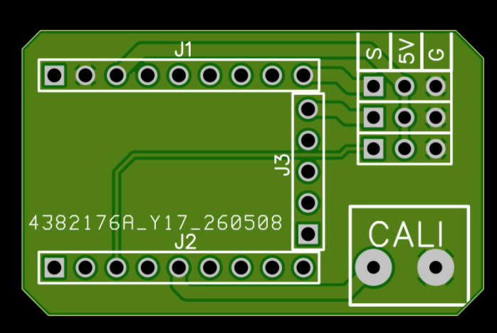

# EasyCanad｜鸭翼迎角反馈控制器

EasyCanad 是基于 Arduino Nano 的独立鸭翼控制实验项目：读取风标迎角和接收机输入，计算全动鸭翼舵机指令。本分支是基于 `main` 的 A 线第一阶段：通过修改源码顶部的 K 参数、重新编译上传，调整线性迎角补偿比例。

> 保留单文件固件和原四个引脚用途，新增 D10 反向舵机输出；PCB 文件不变，不合并 PR #1、PR #2 或 v6。算法测试和 Nano 编译已通过；尚未进行真实 Nano 烧录、台架或飞行测试，详见 [测试记录](TESTING.md)。

## 代码与验证状态

| 版本 | 内容 | 使用说明 |
| --- | --- | --- |
| 本分支 / A 线原型 | 单文件线性补偿：A0 风标、D2 俯仰 PWM、D4 标定按钮、D9 舵机、D10 反向舵机；串口 115200 baud | 见下方“参数设置与上传” |
| [草稿 PR #1](https://github.com/Patrickstarxx/EasyCanad/pull/1) | 模块化 v6 固件：独立手动/辅助模式、地面配置锁定、故障处理、机型模型、日志回放，以及独立配平和可调迎角补偿 | [固件接线与操作](https://github.com/Patrickstarxx/EasyCanad/blob/codex/fix-firmware-control-safety/FIRMWARE.md) · [台架检查表](https://github.com/Patrickstarxx/EasyCanad/blob/codex/fix-firmware-control-safety/BENCH_TEST_PLAN.md) |
| [草稿 PR #2](https://github.com/Patrickstarxx/EasyCanad/pull/2) | 与 v6 配套的 Windows / Android 网页上位机：设备状态、调参、机型档案、日志曲线和模拟设备 | [上位机说明](https://github.com/Patrickstarxx/EasyCanad/blob/codex/host-configurator/host/README.md) |

PR #2 基于 PR #1；使用上位机连接真实控制器时，应配套相应固件。v6 的软件测试和构建检查已通过，风标方向、舵机行程、失控保护、真实 USB 通信及 Android 兼容性仍需实物验证。模型估算速度不是独立测得的空速。

## 参数设置与上传

[`EasyCanad.ino`](EasyCanad.ino) 按约 5 ms 周期计算鸭翼指令，仅控制鸭翼。顶部配置区默认值：

```cpp
const float AOA_COMPENSATION_K = 0.5f;
const float CANARD_TRIM_DEG = 0.0f;
const float AOA_REFERENCE_DEG = 0.0f;
```

| 参数 | 含义 |
| --- | --- |
| `AOA_COMPENSATION_K` | 建议 0～1；0 无迎角补偿，0.5 补偿一半，1 在指令角度上完全补偿迎角变化（未触限幅时） |
| `CANARD_TRIM_DEG` | 中杆且风标处于参考迎角时的基础鸭翼配平指令 |
| `AOA_REFERENCE_DEG` | 相对于 EEPROM 物理零位的参考迎角；例如设为 5，测得 5° 时补偿为零，15° 时按 10° 偏差计算 |

控制律为 `配平 - 飞手输入项 - K × (滤波迎角 - 参考迎角)`。这三个编译期参数均不写 EEPROM；D4 仍只保存传感器物理零位，地址和格式不变，上传程序不会主动擦除或迁移零位。K=0 是软件无补偿状态，仍依赖 Nano 执行程序，不是硬件手动旁路。

1. 将工程文件夹命名为 `EasyCanad`，用 Arduino IDE 打开其中的 `EasyCanad.ino`。
2. 修改顶部参数；保持原有 Arduino AVR Boards、Servo、EEPROM 环境，无新增库。
3. 选择 **Arduino Nano / ATmega328P** 和实际串口；旧引导程序板选择 **ATmega328P (Old Bootloader)**，编译并上传。
4. 重新上电，在台架核对参数、风标方向和鸭翼实际行程，再比较不同 K。

保留 `rcAuthorityDeg`、`canardLimitDeg`、`aoaFilterAlpha`、`CONTROL_PERIOD_US=5000`、1000/1500/2000 μs 接收机映射及原传感器标定参数。

| Nano 引脚 | 本分支用途 |
| --- | --- |
| A0 | 模拟风标迎角输入 |
| D2 | 接收机俯仰 PWM 输入 |
| D4 | 风标零位标定按钮，按下接 GND |
| D9 | 鸭翼舵机信号输出 |
| D10 | 新增反向鸭翼舵机信号输出（`PIN_SERVO_REVERSE`） |

新增一路舵机的信号线接 Nano **D10**，与 Nano 共地。原接线保留，不增加 D3、D5、D7，不修改 PCB、原理图、BOM 文件；现有 PCB 若未引出 D10，需要从 Nano 的 D10 引出信号线。舵机继续使用适合负载的电源供电。

## D10 反向输出

D9 使用最终限幅后的 `canardCmdDeg`，D10 使用 `-canardCmdDeg`；配平、飞手输入与迎角补偿整体反向，共用同一控制周期和限幅。接收机超时后的输出也按同一规则成对更新。

| D9 最终角度指令 | D9 脉宽 | D10 脉宽 |
| --- | --- | --- |
| -45° | 1000 μs | 2000 μs |
| 0° | 1500 μs | 1500 μs |
| +45° | 2000 μs | 1000 μs |

两路都沿用原 544～2400 μs 端点。在未饱和范围，两路绕 1500 μs 反向变化（整数取整可能相差1 μs）；由于原端点不对称，±90° 指令对应 544/2400 μs 或 2400/544 μs，端点处脉宽之和不一定为3000 μs。若需全行程保持脉宽对称，`canardLimitDeg` 应不大于81°，并进一步按真实机构缩小。Servo 库依次发送两路脉冲，更新来自同一控制计算，但脉冲边沿不同时发生。

## 方向、限幅与异常行为

- 原方向不变：相对零位的正迎角增加会减小鸭翼指令；D2 从 1500 增至 2000 μs，`rcAddDeg` 从 0 增至 `+rcAuthorityDeg`，实际叠加项为其负值；正鸭翼指令增加 PWM。实际机头抬起/下俯、舵面正负方向必须台架确认。
- 最终指令限制在 `±clamp(canardLimitDeg, 0, 90)` 后，再按原来的 `-90…+90 → 500…2500 μs` 映射。原 `attach(D9)` 默认实际接受 **544…2400 μs**，本次显式应用相同截断，`ServoUs` 显示截断后的请求值。默认端点可查 [Servo 1.3.0 源码](https://github.com/arduino-libraries/Servo/blob/1.3.0/src/Servo.h)。
- 指令“度”不保证等于真实鸭翼机械偏角。原映射约在 -86.04°、+81° 指令处到达库端点；`canardLimitDeg=90` 只是保留旧默认值，不能证明机构安全。应测量现有机构的无干涉行程，再设置合适限幅；本次不擅自放宽 Servo 端点。
- 风标先相对 EEPROM 零位连续展开，再保留原 ±90° 限幅和一阶滤波；±180° 边界不会直接引起正负饱和换向。相邻样本转动须小于 180°，起始方向由上电/标定时主值确定；不提供多圈绝对角定位，风标连续转整圈后应归位并在地面重新初始化。
- 上电尚无有效脉冲，或距最后有效脉冲超过 100 ms 时，飞手项归零，继续执行配平与迎角补偿，仍限幅；恢复有效脉冲后自动恢复飞手项。正常调度下在阈值后的下一个约 5 ms 控制点处理，D4 EEPROM 写入期间可能延后。脉宽检测仍接受 800～2200 μs，再限制到原 1000～2000 μs 映射。
- `PWMfresh=1` 只表示近期有有效 PWM。接收机失联后输出的有效 Failsafe PWM 同样会被接受，无法据此确认无线连接。需在实际接收机上验证失控输出；此归中策略也不等于飞行安全保证。

## 串口调试

115200 baud；保留 `AOAraw`、`Zero`、`AOA`、`RC`、`Add`、`Cmd`、`ServoUs` 字段，并增加 `K`、`Ref`、`Err`、`Trim`、`Pilot`、`Auto`、`ServoReverseUs`、`PWMfresh`。`ServoUs` 对应 D9，`ServoReverseUs` 对应 D10。`Add` 沿用原正号定义，`Pilot=-Add` 是真正叠加到鸭翼的飞手项；`Auto=-K*Err`；`RC` 是限幅/超时处理后用于控制的脉宽。

每约 100 ms 采集一帧快照，从 `AOAraw` 到 `PWMfresh` 按顺序每行一个字段、每个控制周期最多发送一个字段，共15行；缓冲区不足时延后输出，控制继续。无拥塞时一帧在约 70 ms 内输出完毕。原来单行逗号格式因此变为多行格式。D4 标定信息仍保留，缓冲不足时省略该提示，保存动作不受影响。EEPROM 写入保留原来的同步方式，可能短暂延长标定时的控制间隔，应在地面静止标定。5 ms 是计算周期，Servo 默认脉冲刷新约 20 ms；二者不等同。

## 硬件与资料

- [物料清单](BOM.md)与 [`hardware/`](hardware/) 中的原理图、PCB JSON、导入说明和离线包。
- [`cad/`](cad/) 中的风标叶片与主体模型。
- [`archive/`](archive/) 中的早期固件备份。



现有 PCB 尚未为 v6 新增的 D3 模式、D5 地面跳线和 D7 油门接口改版。按 v6 固件接线前，请先核对实际板卡和引线。

## 目前还缺少的验证

- v6 的台架测量：风标角度、鸭翼真实偏角、舵机端点、方向、延迟、故障退出与接收机失控保护。
- Nano 连接上位机后的读取、写入、保存、重启回读，以及长时间日志采集。
- Android 手机、USB 转接器和具体 Nano USB 芯片的串口兼容性；网页模拟设备仅用于软件交互检查。

完成台架检查前，不应把软件测试通过视为飞行验证通过。
